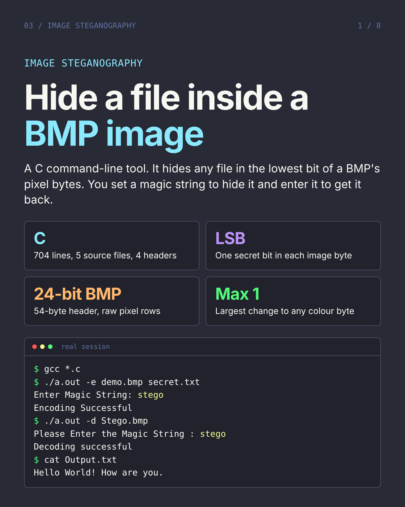
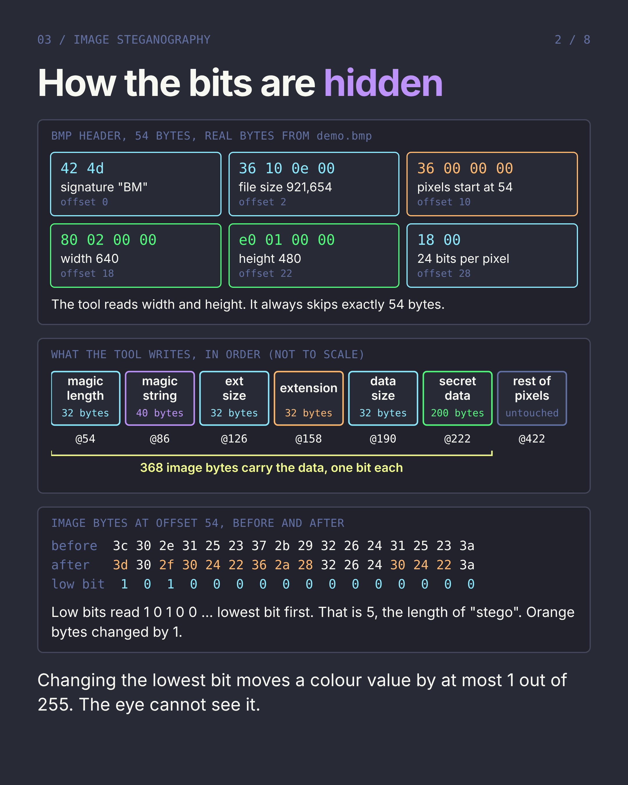
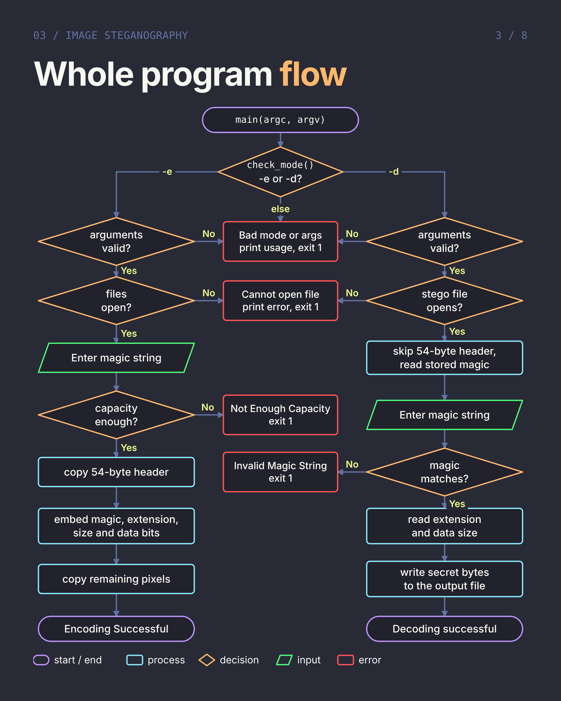
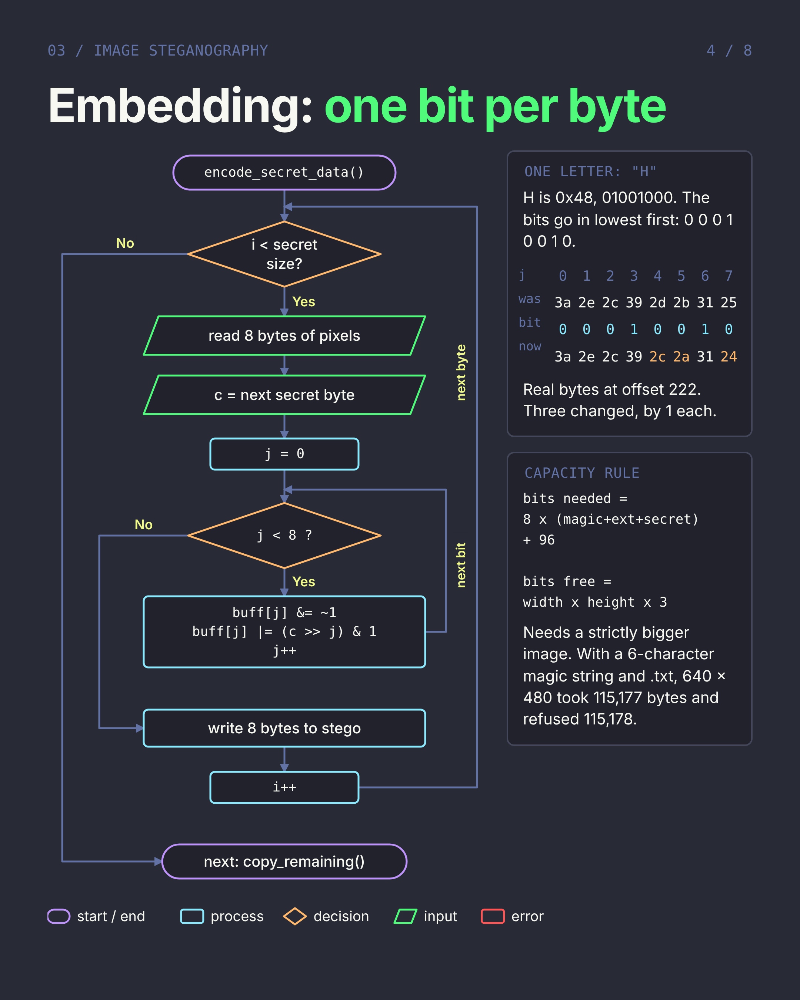
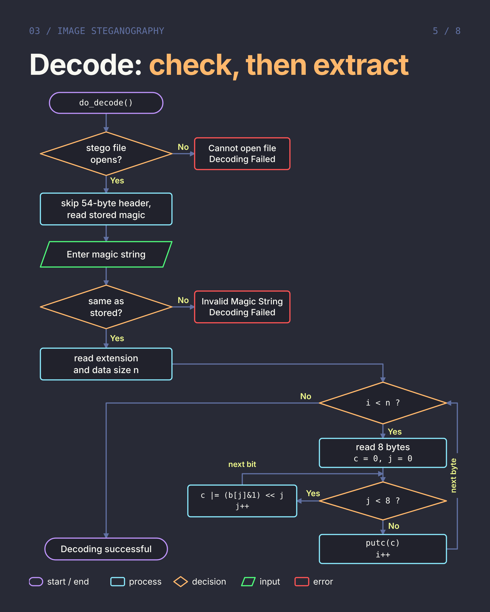
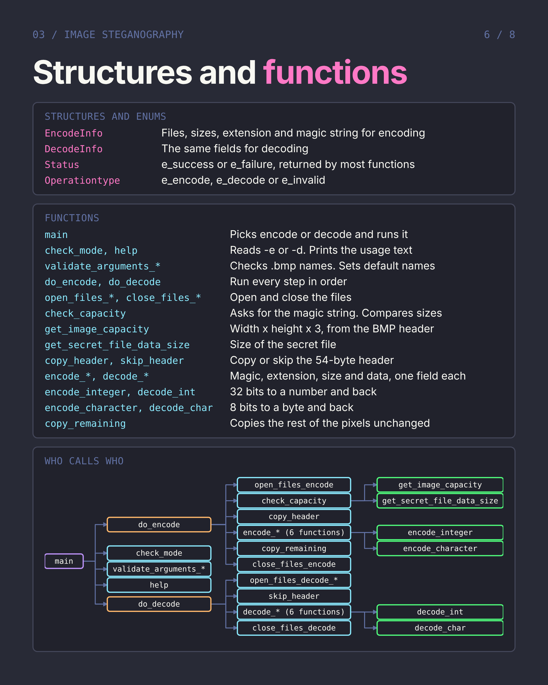
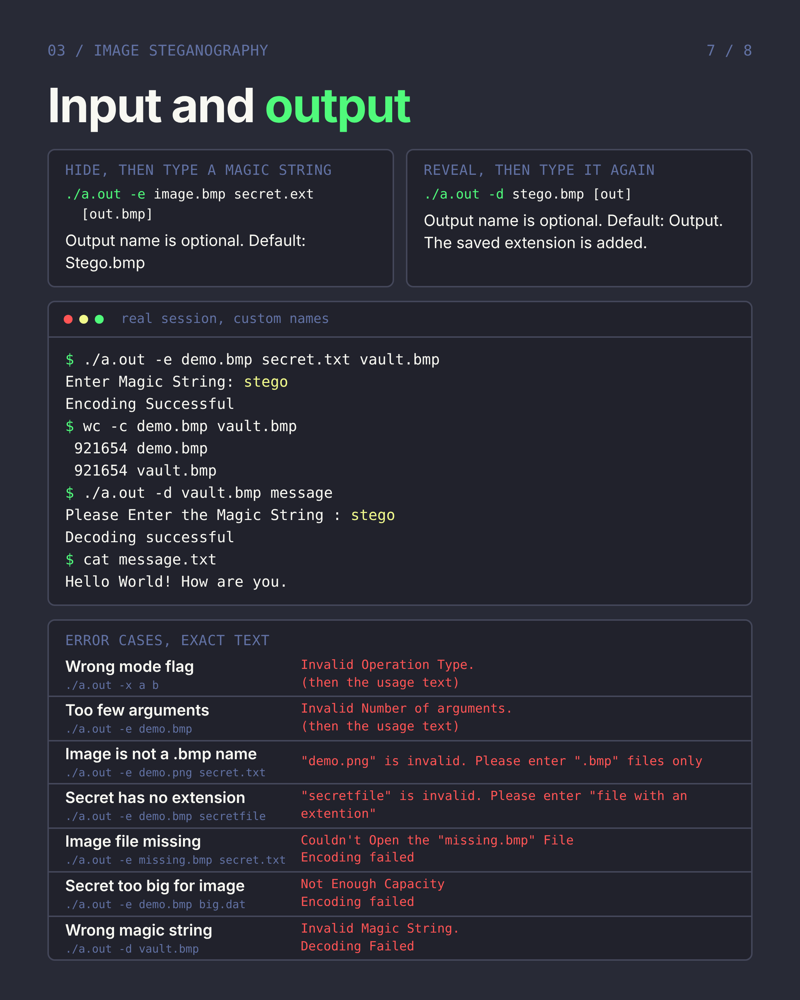
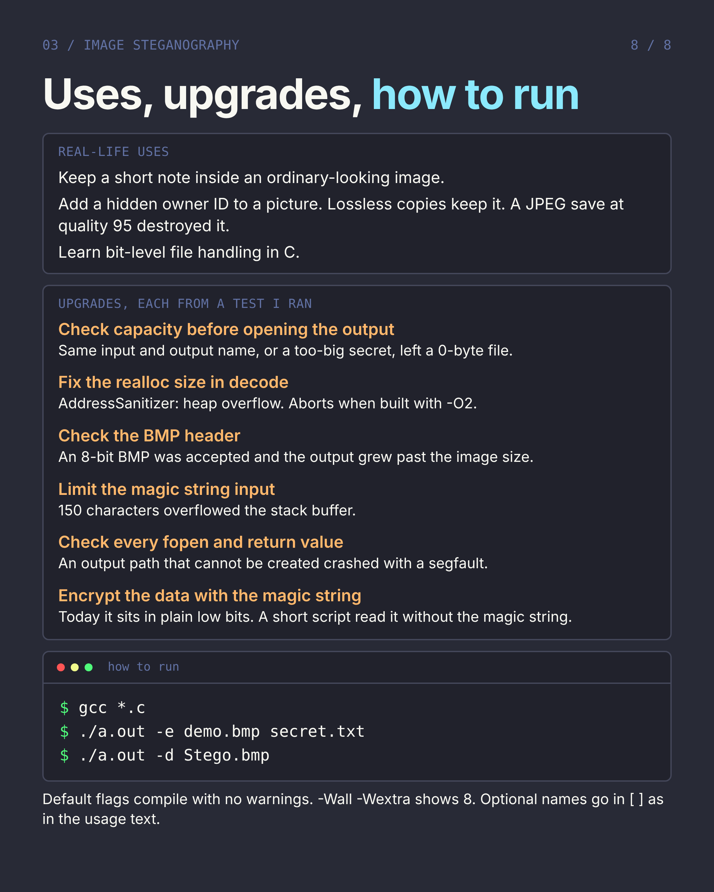

# LSB Image Steganography in C

A command-line steganography utility written in C that hides and extracts secret files inside 24-bit BMP images using Least Significant Bit (LSB) manipulation, bitwise byte reconstruction, and magic string authentication.

## Features

- **Imperceptible LSB Data Hiding:** Embeds 1 bit of secret data into the least significant bit of each RGB pixel byte after the 54-byte BMP header, shifting colour intensity by at most **1 out of 255**.
- **Magic String Authentication:** Secures hidden payloads behind a user-defined magic string that must match during extraction before any data is decoded.
- **Automatic File Extension Preservation:** Stores the original secret file's extension length and extension characters inside the image so any file type (`.txt`, `.c`, `.pdf`, `.jpg`) is restored cleanly.
- **Pre-Encode Capacity Validation:** Reads image width and height directly from the BMP DIB header (`offset 18`) to verify total pixel capacity (`width × height × 3`) before writing data.
- **Strict CLI & File Validation:** Validates operation flags (`-e`, `-d`), argument counts, `.bmp` cover files, and secret file extensions with fallback default output names (`Stego.bmp` and `Output.<ext>`).

## Project Structure

- `main.c` — Entry point that parses command-line arguments (`argc` / `argv`), checks operation mode, and dispatches encoding or decoding workflows.
- `types.c` / `types.h` — Defines core enumerations (`Operationtype`, `Status`) and state structures (`EncodeInfo`, `DecodeInfo`) holding file pointers, buffers, and metadata.
- `image_validate.c` / `image_validate.h` — Verifies CLI argument counts, checks `.bmp` and secret file extensions, and assigns default output filenames when omitted.
- `image_encode.c` / `image_encode.h` — Computes image capacity, copies the 54-byte BMP header, embeds metadata and secret bytes via bitwise LSB operations, and copies remaining image bytes.
- `image_decode.c` / `image_decode.h` — Skips the 54-byte header, extracts and verifies the magic string, reconstructs the file extension and payload bytes, and writes the decoded output file.
- `beautiful.bmp` & `secret.txt` — Sample 24-bit cover image and secret text file included for quick testing.
- `assets/` — Contains the LSB byte layout diagrams, program flowcharts, architecture call graphs, and presentation deck.

## How It Works

### 1. BMP Payload Layout
The first **54 bytes** (the standard BMP file and DIB headers) are copied untouched so the image remains valid and viewable. Starting at byte offset `54`, the encoder embeds 8 bits of image data per 1 byte of secret metadata/payload in sequential order:

| Stage | Field | Image Bytes Used | Purpose |
| :--- | :--- | :--- | :--- |
| 1 | **Magic String Length** | 32 bytes (32 bits) | Stores character count of the magic string |
| 2 | **Magic String** | `magic_len × 8` bytes | Acts as a password/signature to verify hidden data |
| 3 | **Extension Size** | 32 bytes (32 bits) | Stores character count of the secret file extension |
| 4 | **File Extension** | `ext_size × 8` bytes | Preserves original format (e.g., `.txt`) |
| 5 | **Secret File Size** | 32 bytes (32 bits) | Stores total byte size of the secret file |
| 6 | **Secret File Data** | `file_size × 8` bytes | Stores raw binary content of the secret file |
| 7 | **Remaining Image Data** | Unchanged | Copied verbatim to preserve exact original file size |

### 2. Bitwise Encoding & Decoding Logic
- **Encoding (`byte_to_lsb` / `size_to_lsb`):** Clears the lowest bit of each cover image byte (`buff[j] &= ~1`) and sets it to the corresponding bit of the secret byte (`buff[j] |= (ch >> j) & 1`).
- **Decoding (`lsb_to_byte` / `lsb_to_size`):** Reads the lowest bit from 8 consecutive stego image bytes (`ch |= (buff[j] & 1) << j`) to rebuild each original character or 32-bit integer.

### 3. Capacity Formula
Before encoding, the program checks that the cover BMP has enough pixel bytes to hold all metadata (`96` bits for the three 32-bit integer sizes) plus the magic string, extension, and file payload:
```text
Required Bits = 8 × (magic_len + ext_size + secret_file_size) + 96
Available Bits = image_width × image_height × 3
```

## How to Compile & Run

Make sure you have `gcc` installed (Linux, macOS, or Windows with MinGW/WSL):

```bash
gcc main.c types.c image_validate.c image_encode.c image_decode.c -o a.out
```

### Usage Examples

```bash
# Encode with a custom output BMP name
./a.out -e beautiful.bmp secret.txt stego.bmp

# Encode using default output filename (creates Stego.bmp)
./a.out -e beautiful.bmp secret.txt

# Decode with a custom output base name (appends saved extension automatically)
./a.out -d stego.bmp decoded_secret

# Decode using default output filename (creates Output.<ext>)
./a.out -d stego.bmp
```

### Sample Terminal Session

```bash
\$ ./a.out -e beautiful.bmp secret.txt stego.bmp
Enter Magic String: stego
Encoding Successful

\$ wc -c beautiful.bmp stego.bmp
921654 beautiful.bmp
921654 stego.bmp

\$ ./a.out -d stego.bmp decoded_secret
Please Enter the Magic String: stego
Decoding successful

\$ cat decoded_secret.txt
Hello World! How are you.
```

## Error Handling

The CLI validates arguments and file states at each stage and prints clear diagnostic errors:
- `Invalid Operation Type.` — First argument is neither `-e` nor `-d`.
- `Invalid Number of arguments.` — Missing required cover image or secret file arguments.
- `"<file>" is invalid. Please enter ".bmp" files only` — Cover or stego image lacks a `.bmp` extension.
- `"<file>" is invalid. Please enter "file with an extention"` — Secret file has no extension separator (`.`).
- `Not Enough Capacity` — Cover BMP resolution is too small to store the secret payload and metadata.
- `Invalid Magic String.` — Entered magic string does not match the signature embedded in the stego image.

## Program Flow & Architecture

📄 **[View Full Presentation Deck (PDF)](./assets/image-steganography-presentation.pdf)**

### 1. Overview & LSB Payload Layout



### 2. Core Operations Flowcharts




### 3. Data Structures, CLI & Terminal Output



## Future Upgrades



- **Pre-Flight Capacity & Path Check:** Validate capacity and destination paths before opening output files.
- **Strict 24-Bit DIB Header Validation:** Verify `bits_per_pixel == 24` at header offset `28`.
- **Bounded Buffer Input:** Replace unbounded reads with length-checked input to prevent overflows.
- **Memory & File Pointer Safety:** Ensure proper sizing and validate all `fopen` return pointers.
- **Symmetric Payload Encryption:** Encrypt payload bits using a key derived from the magic string.

